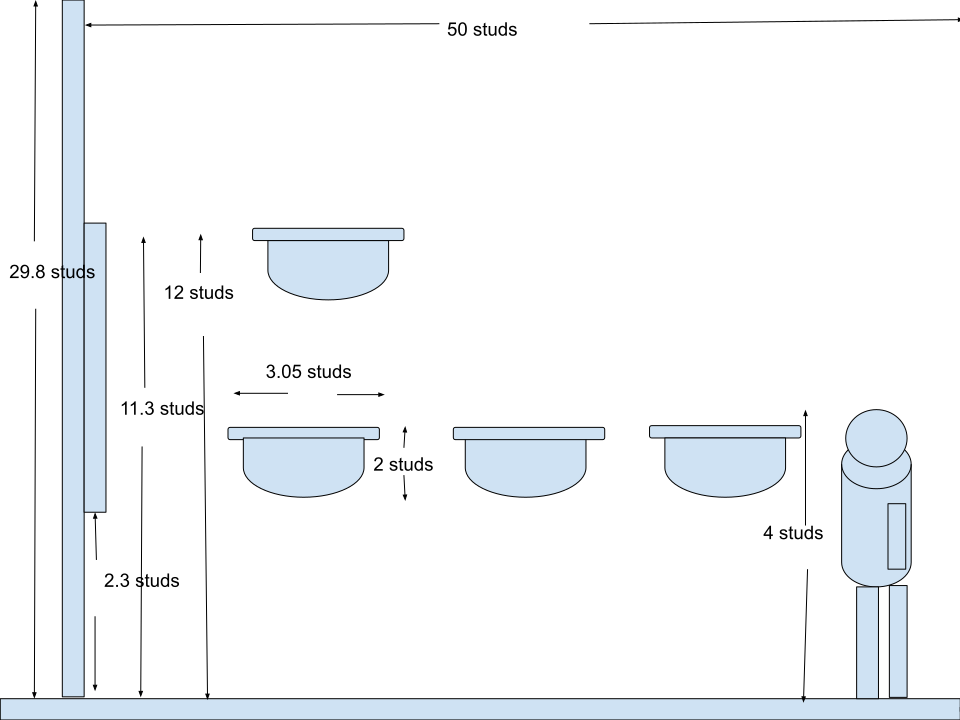

# Roblox Zone C Tsukiji Outer Market Area Design Spec

Based on `room-spatial-dimension-spec.md` and `info-board-featured-spots.md`, this document defines the 3D spatial design, elevation and plan layout specifications, and placement transforms and dynamic appearance animation control specifications for surrounding 3D food props (such as sushi objects) in the area in front of **InfoBoard_13_TsukijiOuterMarket** located on `MainWall_04` (south side) in Zone C.

## 🏛️ Area Overview & Spatial Concept

The area in front of `InfoBoard_13_TsukijiOuterMarket` is a main exhibition zone in Zone C where visitors can experience and view the vibrant seafood and sushi culture of the Tsukiji Outer Market.
Centered around the featured sightseeing information board (`InfoBoard_13`) mounted on the wall, 3D food props (various sushi 3D Models: Toro, Tamago, and Salmon) are deployed on the Zone C floor in front (`Y = 0.2 studs`) and above the information board (`Y = 15.0 studs`).
When a player approaches the front of the information board, the design builds an interactive effect in which the sushi props pop up along the movement direction and line of sight, enhancing immersion.

## 📐 Elevation & Plan Layout Specifications

The composition and dimensional specifications for elevation and plan in this area conform to the following SVG design drawings managed as assets.

### 1. Elevation Spec
- **Reference Asset**: `tsukiji-outer-market-elevation-spec.svg` (`./roblox-world/assets/tsukiji-outer-market-elevation-spec.svg`)
  `
- **Key Structures**:
  * **MainWall_04**: Height `30.0 studs` / Thickness `2.0 studs` / Wood-grain finish
  * **InfoBoard_13_TsukijiOuterMarket**:
    * Wall Mount center height: `Y = 7.00 studs`
    * Size: `12.0, 9.0, 0.4 studs`
    * Front `Display_Surface` (`SurfaceGui 1024x768`): Left area description text / Right outer market visual image
  * **Floor Placement Level**: Zone C floor Top Elevation `Y = 0.20 studs` (Floor prop placement reference plane: `Y = 4.00 studs` / Aerial prop placement reference plane: `Y = 15.00 studs`)

### 2. Plan Spec
- **Reference Asset**: `tsukiji-outer-market-plan-spec.svg` (`./roblox-world/assets/tsukiji-outer-market-plan-spec.svg`)
  `
- **Layout Axes**:
  * `MainWall_04` wall position: `Z = 107.00 studs`
  * `InfoBoard_13` placement position: `X = 22.00 studs, Z = 105.00 studs`
  * Exhibition prop group deployment area: `X = 15.0 ~ 37.0 studs, Z = 68.0 ~ 94.0 studs` (Walking and viewing zone in front of `InfoBoard_13`)

## 🍣 3D Object & Prop Deployment Transform Table

Coordinate list of 3D objects (sushi prop group) adjusted and placed on the floor (`Y = 4.0 studs`) and above the information board (`Y = 15.0 studs`) in the area in front of `InfoBoard_13`.
A sequential appearance sequence of 3 rows plus an upper group is configured along the movement direction from the Zone B side (`Z = 68.50`) toward the InfoBoard side (`Z = 93.50`) and above the information board (`Z = 101.79 ~ 102.59`).

### Prop Placement Table

| Prop Name / Object ID | Item Type / Description | Position (X, Y, Z) | Orientation (Rx, Ry, Rz) | Parent Folder / Workspace Hierarchy | Sequential Step |
| :--- | :--- | :--- | :--- | :--- | :--- |
| Prop_Sushi_Toro_03 | Fatty Tuna (Row 1: Zone B side) | (28, 4, 82.5) | (0, 0, 0) | Workspace.Props.TsukijiArea / Prop_Sushi_Toro_03 | Step 1 (Simultaneous) |
| Prop_Sushi_Tamago_03 | Egg (Row 1: Zone B side) | (24, 5, 82.5) | (0, 0, 0) | Workspace.Props.TsukijiArea / Prop_Sushi_Tamago_03 | Step 1 (Simultaneous) |
| Prop_Sushi_Salmon_03 | Salmon (Row 1: Zone B side) | (14.5, 4, 82.5) | (0, 0, 0) | Workspace.Props.TsukijiArea / Prop_Sushi_Salmon_03 | Step 2 |
| Prop_Sushi_Toro_02 | Fatty Tuna (Row 2: Center) | (15.5, 4, 91) | (0, 0, 0) | Workspace.Props.TsukijiArea / Prop_Sushi_Toro_02 | Step 3 (Simultaneous) |
| Prop_Sushi_Tamago_02 | Egg (Row 2: Center) | (19.5, 4, 91) | (0, 0, 0) | Workspace.Props.TsukijiArea / Prop_Sushi_Tamago_02 | Step 3 (Simultaneous) |
| Prop_Sushi_Salmon_02 | Salmon (Row 2: Center) | (29.5, 4, 91) | (0, 0, 0) | Workspace.Props.TsukijiArea / Prop_Sushi_Salmon_02 | Step 4 |
| Prop_Sushi_Toro_01 | Fatty Tuna (Row 3: In front of board) | (33, 4, 98.5) | (0, 0, 0) | Workspace.Props.TsukijiArea / Prop_Sushi_Toro_01 | Step 5 (Simultaneous) |
| Prop_Sushi_Tamago_01 | Egg (Row 3: In front of board) | (29, 4, 98.5) | (0, 0, 0) | Workspace.Props.TsukijiArea / Prop_Sushi_Tamago_01 | Step 5 (Simultaneous) |
| Prop_Sushi_Salmon_01 | Salmon (Row 3: In front of board) | (19.5, 4, 98.5) | (0, 0, 0) | Workspace.Props.TsukijiArea / Prop_Sushi_Salmon_01 | Step 6 |
| Prop_Sushi_Toro_04 | Fatty Tuna (Upper) | (30, 12, 101.5) | (-19.47, 21.21, -9.12) | Workspace.Props.TsukijiArea / Prop_Sushi_Toro_04 | Step 7 (Simultaneous) |
| Prop_Sushi_Tamago_04 | Egg (Upper) | (26.5, 12, 102.5) | (0, 0, 0) | Workspace.Props.TsukijiArea / Prop_Sushi_Tamago_04 | Step 7 (Simultaneous) |
| Prop_Sushi_Salmon_04 | Salmon (Upper) | (20, 10, 104.5) | (-29.587, -32.674, 17.571) | Workspace.Props.TsukijiArea / Prop_Sushi_Salmon_04 | Step 7 (Simultaneous) |

## ⚡ Dynamic Appearance & Audio System Architecture

To optimize performance in multiplayer environments including mobile devices and reduce network load, the prop appearance gimmick in this area is built and executed via client-side control (`LocalScript`).

### 1. Detection & Trigger Control (Combined Distance and Front-Facing Individual Evaluation)
- **Script Placement**: Placed as a `LocalScript` under `StarterPlayer.StarterPlayerScripts`.
- **Target Object Reference**: Dynamically references `Workspace.Featured_Sightseeing_Spots_Boards.InfoBoard_13_TsukijiOuterMarket`.
- **Sensing Logic (Distance and Front Determination)**:
  * Monitors the distance between each logged-in player's own character (`HumanoidRootPart`) and `InfoBoard_13_TsukijiOuterMarket` on `RunService.Heartbeat`, detecting when the player is within **40 studs** and in front of the board.
  * Calculates the horizontal (XZ plane) dot product between the board's front direction vector (`-boardPivot.LookVector`) and the player position, applying a strict viewing-angle threshold (`threshold > 0.9`) to prevent false triggers from adjacent boards.
  * As a close-range fallback, if a player comes within **15 studs** of the board, they are treated as being in front regardless of angle, preventing unexpected hiding caused by minor movement jitter.
- **Trigger Condition**: Starts the appearance sequence when approaching under valid conditions (`isInFront = true`), and resets all props to a hidden state when moving outside the conditions.

### 2. Popup Animation & SE Playback Mechanism
- **Initial State Management**:
  * To prevent flickering (instant appearance) at game start due to network lag, all prop properties are pre-configured in Roblox Studio with `Transparency = 1` and `CanCollide = false`.
  * The initialization function `hideAllSushi()` executed at script startup retains original size and `CFrame` data and hides props as a safety net.
- **Centralized Sound Management**:
  * Places the pop sound asset `SE_Pop_Common` (`SoundId: rbxassetid://100517105966579`) under the `Workspace.AudioAssets` folder for centralized management.
- **Pop-Up Animation Effect (`TweenService`)**:
  * Maintains `CanCollide = false` during animation execution to prevent player movement snagging.
  * When each prop appears, performs a popup interpolation over approximately `0.35 seconds` from a downward offset (`-1.5` to `-5 studs`) and shrunk state (`scale 0.2`) to its original position and size using `Enum.EasingStyle.Back` and `Enum.EasingDirection.Out`.
  * Simultaneously with the start of the popup effect, resets `SE_Pop_Common` playback position (`TimePosition = 0`) to sequentially play the "pop" sound effect.

### 3. Staggered Appearance Sequence (From Zone B Side Along Movement Direction)
Following the movement path of players advancing from the Zone B side toward the board, staggered appearance is executed across 7 steps (interval per step: `DELAY_TIME = 0.25 seconds`).

    Step 1: [Row 1 (Zone B side)] Prop_Sushi_Toro_03 & Prop_Sushi_Tamago_03 pop up with SE
    Step 2: [Row 1 (Zone B side)] Prop_Sushi_Salmon_03 pops up with SE
    Step 3: [Row 2 (Center)] Prop_Sushi_Toro_02 & Prop_Sushi_Tamago_02 pop up with SE
    Step 4: [Row 2 (Center)] Prop_Sushi_Salmon_02 pops up with SE
    Step 5: [Row 3 (In front of board)] Prop_Sushi_Toro_01 & Prop_Sushi_Tamago_01 pop up with SE
    Step 6: [Row 3 (In front of board)] Prop_Sushi_Salmon_01 pops up with SE
    Step 7: [Upper (Above board)] Prop_Sushi_Toro_04 & Prop_Sushi_Tamago_04 & Prop_Sushi_Salmon_04 pop up simultaneously with SE

## 📂 Service & Workspace Hierarchy Integration

All objects, client scripts, and sound assets in the Tsukiji area are organized and stored according to the following hierarchy.

    Workspace
    ├── Featured_Sightseeing_Spots_Boards
    │   └── InfoBoard_13_TsukijiOuterMarket
    ├── Props
    │   └── TsukijiArea
    │       ├── Prop_Sushi_Toro_01
    │       ├── Prop_Sushi_Toro_02
    │       ├── Prop_Sushi_Toro_03
    │       ├── Prop_Sushi_Toro_04
    │       ├── Prop_Sushi_Tamago_01
    │       ├── Prop_Sushi_Tamago_02
    │       ├── Prop_Sushi_Tamago_03
    │       ├── Prop_Sushi_Tamago_04
    │       ├── Prop_Sushi_Salmon_01
    │       ├── Prop_Sushi_Salmon_02
    │       ├── Prop_Sushi_Salmon_03
    │       └── Prop_Sushi_Salmon_04
    └── AudioAssets
        └── SE_Pop_Common (Sound)

    StarterPlayer
    └── StarterPlayerScripts
        └── Tsukiji_PropController (LocalScript)

## 🔗 Related Documentation & Links

- Main Index: `../index.md`
- Overall Object Deployment Plan: `../object-deployment-plan.md`
- Spatial Coordinates & Dimension Calculation Spec: `./room-spatial-dimension-spec.md`
- Featured Sightseeing Spots Info Board Spec: `./info-board-featured-spots.md`
- Workspace Hierarchy Spec: `./workspace-hierarchy.md`
